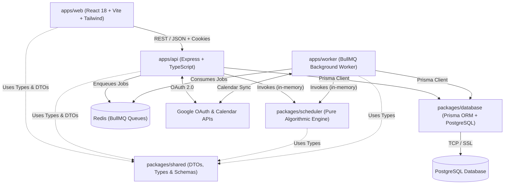

# Tempo — Codebase Architecture & Navigation Map

Welcome to the primary architectural and operational guide for **Tempo** (*Find your rhythm*). This documentation map is designed for engineers and AI agents to quickly understand the codebase, pinpoint relevant files and execution flows, and implement changes with minimal exploration and zero guesswork.

---

## 1. Project Overview & Architecture Summary

Tempo is a daily productivity, scheduling, and habit management application tailored for students and busy professionals. It combines fixed university/work timetable constraints, personal recurring routines (meals, exercise, commute, sleep), and task prioritization into an intelligent, minimal-change scheduling engine.

### High-Level Topology



---

## 2. Monorepo Structure

The project is structured as a `pnpm` monorepo managed via `pnpm-workspace.yaml`:

```text
tempo-monorepo/
├── apps/
│   ├── api/          # Express REST API service (port 5000)
│   ├── web/          # React + Vite mobile-first PWA frontend (port 3000 / 3001)
│   └── worker/       # BullMQ background job processing service
├── packages/
│   ├── database/     # Prisma schema, migrations, seed scripts, and client
│   ├── scheduler/    # Pure TypeScript deterministic scheduling & rescheduling engine
│   └── shared/       # Shared DTOs, Zod validation schemas, interfaces, constants
├── docs/
│   └── codebase-map/ # Maintained architectural and navigation maps
├── package.json      # Root monorepo scripts & dev dependencies
└── pnpm-workspace.yaml
```

---

## 3. Applications & Packages

| Project | Type | Description | Main Entry Point |
|---|---|---|---|
| [`apps/api`](file:///c:/Users/mevin_z1mcnwj/Desktop/time%20magement/apps/api) | Application | REST API with Express, cookie-based sessions, OAuth, rate limiting, and CSRF protection. | [`apps/api/src/index.ts`](file:///c:/Users/mevin_z1mcnwj/Desktop/time%20magement/apps/api/src/index.ts) |
| [`apps/web`](file:///c:/Users/mevin_z1mcnwj/Desktop/time%20magement/apps/web) | Application | Mobile-first monochrome React 18 SPA, Vite, Tailwind CSS, local Caveat/Inter fonts. | [`apps/web/src/main.tsx`](file:///c:/Users/mevin_z1mcnwj/Desktop/time%20magement/apps/web/src/main.tsx) |
| [`apps/worker`](file:///c:/Users/mevin_z1mcnwj/Desktop/time%20magement/apps/worker) | Application | BullMQ queue worker for nightly planning, reminders, calendar synchronization, cleanup. | [`apps/worker/src/index.ts`](file:///c:/Users/mevin_z1mcnwj/Desktop/time%20magement/apps/worker/src/index.ts) |
| [`packages/database`](file:///c:/Users/mevin_z1mcnwj/Desktop/time%20magement/packages/database) | Package | Prisma schema, PostgreSQL migrations, Prisma Client wrapper, and seeders. | [`packages/database/src/index.ts`](file:///c:/Users/mevin_z1mcnwj/Desktop/time%20magement/packages/database/src/index.ts) |
| [`packages/scheduler`](file:///c:/Users/mevin_z1mcnwj/Desktop/time%20magement/packages/scheduler) | Package | Zero-dependency scheduling engine: interval math, availability, scoring, allocation, rescheduling. | [`packages/scheduler/src/index.ts`](file:///c:/Users/mevin_z1mcnwj/Desktop/time%20magement/packages/scheduler/src/index.ts) |
| [`packages/shared`](file:///c:/Users/mevin_z1mcnwj/Desktop/time%20magement/packages/shared) | Package | Unified Zod schemas, TypeScript DTOs, regexes, and configuration constants. | [`packages/shared/src/index.ts`](file:///c:/Users/mevin_z1mcnwj/Desktop/time%20magement/packages/shared/src/index.ts) |

---

## 4. Communication & Data Flow

1. **Frontend to API**:
   - Browser client uses `apiRequest()` from [`apps/web/src/api/client.ts`](file:///c:/Users/mevin_z1mcnwj/Desktop/time%20magement/apps/web/src/api/client.ts).
   - In development, Vite proxies `/api` and `/health` requests from port 3000 to port 5000 (`http://localhost:5000`).
   - Authentication is maintained via HTTP-only secure cookie (`tempo_session`).
   - State-changing requests (`POST`, `PUT`, `DELETE`, `PATCH`) automatically send the `X-Requested-With: XMLHttpRequest` CSRF protection header.
2. **API to Scheduler**:
   - In-process library call: [`apps/api/src/services/scheduler.service.ts`](file:///c:/Users/mevin_z1mcnwj/Desktop/time%20magement/apps/api/src/services/scheduler.service.ts) loads user preferences, routines, events, and tasks from the database, transforms them into `SchedulerRequest`, and invokes `defaultSchedulerEngine.generateSchedule()` or `rescheduleMinimalChange()`.
3. **API / Worker to Database**:
   - Both import the singleton `prisma` client from `@tempo/database`.
4. **API to Worker**:
   - API produces jobs into Redis BullMQ queues via [`apps/api/src/queue/index.ts`](file:///c:/Users/mevin_z1mcnwj/Desktop/time%20magement/apps/api/src/queue/index.ts).
   - Worker consumes queues in [`apps/worker/src/index.ts`](file:///c:/Users/mevin_z1mcnwj/Desktop/time%20magement/apps/worker/src/index.ts) with dedicated processors.

---

## 5. Documentation Directory Index

Read the specific document relevant to your task before touching any code:

1. [**`architecture.md`**](file:///c:/Users/mevin_z1mcnwj/Desktop/time%20magement/docs/codebase-map/architecture.md): System architecture, process topology, security boundaries, and communication patterns.
2. [**`frontend-map.md`**](file:///c:/Users/mevin_z1mcnwj/Desktop/time%20magement/docs/codebase-map/frontend-map.md): Frontend routes, layouts, pages, components, client configuration, and responsive design patterns.
3. [**`backend-map.md`**](file:///c:/Users/mevin_z1mcnwj/Desktop/time%20magement/docs/codebase-map/backend-map.md): Express app setup, route definitions, middleware pipeline, service layer, and queue producers.
4. [**`database-map.md`**](file:///c:/Users/mevin_z1mcnwj/Desktop/time%20magement/docs/codebase-map/database-map.md): Prisma models, relationships, enums, migrations, and database access conventions.
5. [**`scheduler-map.md`**](file:///c:/Users/mevin_z1mcnwj/Desktop/time%20magement/docs/codebase-map/scheduler-map.md): The core scheduling algorithm: availability, routine/sleep constraints, scoring, allocation, validation, and rescheduling.
6. [**`feature-file-index.md`**](file:///c:/Users/mevin_z1mcnwj/Desktop/time%20magement/docs/codebase-map/feature-file-index.md): Instant feature-to-file reference table (pages, components, routes, services, models, tests).
7. [**`development-guide.md`**](file:///c:/Users/mevin_z1mcnwj/Desktop/time%20magement/docs/codebase-map/development-guide.md): Development setup, scripts, environment variables, testing, and operational rules.

---

## 6. Essential Development Commands

```bash
# Start all services concurrently (API, Web, Worker)
pnpm dev

# Start individual services
pnpm dev:api       # Express API (http://localhost:5000)
pnpm dev:web       # Vite Web (http://localhost:3000)
pnpm dev:worker    # BullMQ Background Worker

# Build & Typecheck
pnpm build         # Build packages and applications in dependency order
pnpm typecheck     # Typecheck all packages with tsc --noEmit

# Tests & Quality
pnpm test          # Run Vitest test suite in apps/api
pnpm lint          # Run ESLint across packages
pnpm format:check  # Check formatting with Prettier
pnpm format        # Automatically format files with Prettier

# Database Commands
pnpm db:generate   # Generate Prisma Client
pnpm db:push       # Push schema directly to database (dev)
pnpm db:seed       # Run seed script
pnpm db:studio     # Launch Prisma Studio GUI
```

---

## 7. Future Maintenance Rule

Whenever a future engineering task alters architecture, introduces a new feature, relocates files, changes API contracts, or modifies database schema:
1. **Update only the affected codebase-map documents** (`architecture.md`, `frontend-map.md`, `backend-map.md`, `database-map.md`, `scheduler-map.md`, `feature-file-index.md`, or `development-guide.md`).
2. **Do NOT rewrite or regenerate the entire map** for minor UI fixes or localized bug patches.
3. **Verify actual source paths** before documenting. Never invent routes, files, or parameters.

---

## 8. Future Antigravity Execution Rule

Before implementing a future feature or bug fix:
1. Read this [`README.md`](file:///c:/Users/mevin_z1mcnwj/Desktop/time%20magement/docs/codebase-map/README.md).
2. Read **only** the relevant feature map from [`docs/codebase-map/`](file:///c:/Users/mevin_z1mcnwj/Desktop/time%20magement/docs/codebase-map).
3. Identify the exact files and dependencies involved using [`feature-file-index.md`](file:///c:/Users/mevin_z1mcnwj/Desktop/time%20magement/docs/codebase-map/feature-file-index.md).
4. Verify those specific files against current source code.
5. Implement the requested change with the minimum necessary edits and zero broad repository exploration.
6. Update the documentation map only if the change materially affects architecture or file organization.

