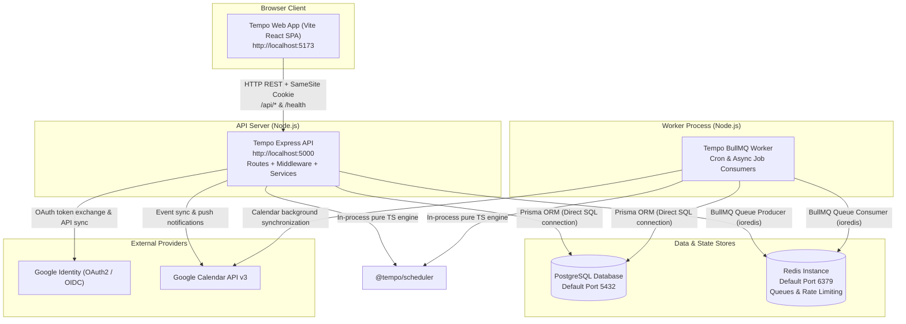
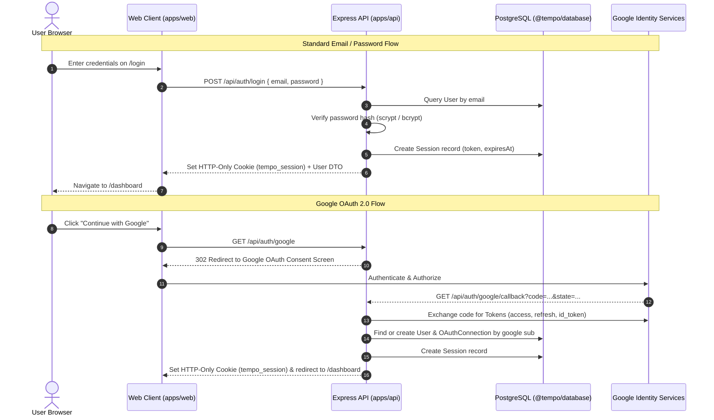
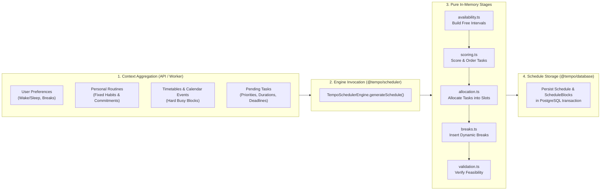
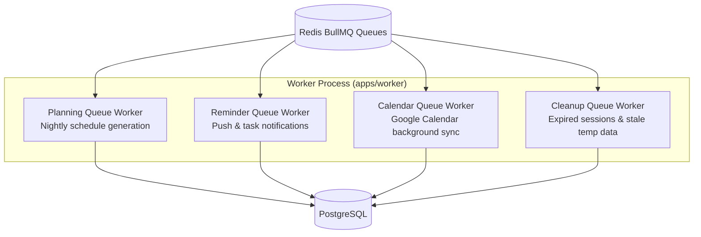

# System Architecture & Topology

This document describes the architectural layout, process boundaries, execution flows, and integration mechanisms of the Tempo system.

---

## 1. Monorepo Structure & Process Boundaries

Tempo is structured as an npm/pnpm workspace monorepo consisting of **three runtime applications** and **three shared packages**:

```
tempo/
├── apps/
│   ├── web/        # React 18 SPA (Vite, Tailwind, React Router v7)
│   ├── api/        # Express 4 REST API (TypeScript, Prisma, Sessions)
│   └── worker/     # BullMQ Background Worker (TypeScript, Redis, Cron/Events)
└── packages/
    ├── database/   # Prisma schema, migrations, seeders & PrismaClient singleton
    ├── scheduler/  # Pure TypeScript deterministic scheduling engine
    └── shared/     # Shared Zod schemas, TypeScript types/DTOs, constants
```

### Process Isolation & Network Boundaries



---

## 2. Shared Packages Architecture

### `@tempo/database` (`packages/database`)
- **Location:** `packages/database/src/index.ts`
- **Schema:** `packages/database/prisma/schema.prisma`
- **Responsibilities:**
  - Exports a singleton `prisma` client (`PrismaClient`).
  - Contains database migrations in `packages/database/prisma/migrations/`.
  - Exports helper functions: `connectDatabase()`, `disconnectDatabase()`, `isDatabaseHealthy()`.
  - Re-exports all generated Prisma types (`User`, `Task`, `Schedule`, `PersonalRoutine`, etc.).

### `@tempo/scheduler` (`packages/scheduler`)
- **Location:** `packages/scheduler/src/index.ts`
- **Responsibilities:**
  - Zero-dependency, pure TypeScript deterministic constraint-satisfaction engine.
  - Implements interval algebra, availability calculation, scoring, task allocation, break insertion, minimal-change rescheduling, and validation.
  - Consumed directly in-memory by `apps/api` (`scheduler.service.ts`) and `apps/worker` (`planning.worker.ts`).

### `@tempo/shared` (`packages/shared`)
- **Location:** `packages/shared/src/index.ts`
- **Responsibilities:**
  - Single source of truth for Zod schemas (`loginSchema`, `createTaskSchema`, `personalRoutineSchema`, etc.).
  - TypeScript interfaces, API response types (`ApiResponse<T>`), and request DTOs.
  - Global configuration constants (`APP_CONFIG`, time constants, priority weights).

---

## 3. Authentication Architecture

Tempo uses a **cookie-based session token** architecture combined with **Google OAuth 2.0 / OpenID Connect**.



### Session Handling & Middleware Pipeline
1. **Cookie Storage:** The session token is stored in an `httpOnly`, `sameSite: "lax"`, signed/secure cookie named `tempo_session` (configured in `apps/api/src/config.ts`).
2. **Session Verification (`apps/api/src/middleware/auth.ts`):**
   - Extracts session token from cookie.
   - Looks up `Session` in database including user details.
   - If missing or expired: returns `401 Unauthorized` and clears the cookie.
   - If database error or connection failure occurs: returns `503 Service Unavailable` without clearing cookie.
   - Attaches `req.user` and `req.session` to the Express Request.
3. **Session Revocation:**
   - On `POST /api/auth/logout`: deletes session record from DB and clears the cookie.

---

## 4. Scheduler Integration Architecture

The scheduling engine (`@tempo/scheduler`) is designed as a stateless, deterministic calculator.



- **Execution Contexts:**
  1. **Interactive API:** When user visits the Schedule page or clicks "Regenerate", `scheduler.controller.ts` calls `scheduler.service.ts`, which runs the engine synchronously and returns candidate or confirmed blocks.
  2. **Minimal-Change Rescheduling:** Triggered when an event runs over or a user delays a task. Calls `rescheduleMinimalChange` to shift only affected blocks while pinning locked blocks.
  3. **Nightly Worker:** BullMQ planning queue job runs nightly to build tomorrow's draft schedule for active users.

---

## 5. Background Worker Architecture (`apps/worker`)

The worker application runs as a separate Node.js process listening to BullMQ queues backed by Redis.



### Queue Definitions (`apps/api/src/queue/` and `apps/worker/src/queues/`)
- `planning`: Dispatches daily schedule pre-computation.
- `reminders`: Dispatches upcoming block reminders and web push notifications.
- `calendar-sync`: Background synchronization of Google Calendar events and webhook notifications.
- `cleanup`: Purges revoked sessions, expired tokens, and temporary schedule drafts.

---

## 6. Architecture Invariants & Rules

1. **No Direct Database Access from Frontend:** The frontend (`apps/web`) communicates exclusively via HTTP REST with `apps/api`.
2. **Scheduler Independence:** `@tempo/scheduler` has zero external dependencies and must never import database clients, network libraries, or UI code.
3. **Database Client Singleton:** Never instantiate `new PrismaClient()` in controllers or routes. Always import the shared instance from `@tempo/database`.
4. **Validation Separation:** API request payloads must be validated against `@tempo/shared` Zod schemas using `validateRequest` middleware before reaching service layers.

