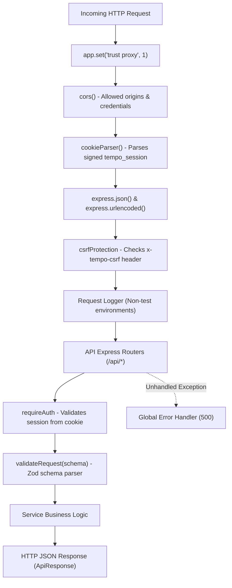

# Backend API Codebase Map

This document details the architecture, routing, middleware pipeline, service layer, queue producers, and error-handling standards for `apps/api`.

---

## 1. Server Entry Points & Lifecycle

```
apps/api/src/
├── index.ts        # Process entry point: port binding, graceful shutdown, DB connection
├── app.ts          # Express application factory: createApp(), middleware registration, routes
├── config.ts       # Environment variable parsing, default ports, CORS origins, cookie config
└── db.ts           # Database connection helpers re-exported from @tempo/database
```

### Lifecycle & Startup Sequence (`apps/api/src/index.ts`)
1. **Load Environment:** Reads `.env` from repository root.
2. **Connect Database:** Calls `connectDatabase()` from `@tempo/database`.
3. **Instantiate Express:** Calls `createApp()` from `app.ts`.
4. **Bind Port:** Listens on `PORT` (default `5000` or `3000` fallback).
5. **Signal Handlers:** Binds `SIGTERM` and `SIGINT` for graceful connection closure and database disconnect.

---

## 2. Middleware Pipeline (`apps/api/src/middleware/`)

Requests execute through the following ordered pipeline:



### Middleware Reference
- **CSRF Protection (`middleware/csrf.ts`):** Enforces `x-tempo-csrf: 1` on mutation methods (`POST`, `PUT`, `PATCH`, `DELETE`). Safe methods (`GET`, `HEAD`, `OPTIONS`) and OAuth callback endpoints bypass this check.
- **Authentication (`middleware/auth.ts`):**
  - `requireAuth`: Reads `tempo_session` cookie. Validates session in database. Sets `req.user` and `req.session`.
  - Missing/expired session returns `401 Unauthorized` and clears the cookie.
  - Database connection failures return `503 Service Unavailable` without clearing the cookie.
  - `optionalAuth`: Populates `req.user` if session cookie is present and valid; continues without error if absent.
- **Rate Limiting (`middleware/rateLimit.ts`):** In-memory or Redis-backed rate limiter for authentication routes (`/api/auth/login`, `/api/auth/register`) preventing brute force attacks.
- **Request Validation (`middleware/validate.ts`):** `validateRequest(zodSchema)` validates `req.body`, `req.query`, or `req.params`. Emits `400 Bad Request` with structured field errors on failure.

---

## 3. Route-to-Service Mapping Table

All API endpoints are mounted under `/api` in `apps/api/src/app.ts`:

| Route Prefix | Route File | Controller / Service File | Primary Responsibilities |
|---|---|---|---|
| `/api/auth` | `routes/auth.routes.ts` | `services/auth.service.ts` | Login, registration, session validation (`/me`), logout, password changes |
| `/api/auth/google` | `routes/google-auth.routes.ts` | `services/google-auth.service.ts` | Google OAuth2 consent redirect, code exchange, account linking, unlink |
| `/api/profile` | `routes/profile.routes.ts` | `services/user.service.ts` | User account information, avatar, profile details |
| `/api/preferences` | `routes/preference.routes.ts` | `services/preference.service.ts` | Wake/sleep times, break duration, day-of-week wake times |
| `/api/routines` | `routes/routine.routes.ts` | `services/routine.service.ts` | Personal routine CRUD (meals, exercise, recurring commitments) |
| `/api/categories` | `routes/category.routes.ts` | `services/category.service.ts` | Task categories, colors, user categorization |
| `/api/tasks` | `routes/task.routes.ts` | `services/task.service.ts` | Task CRUD, status updates, priority, energy level, deadlines |
| `/api/recurring-tasks` | `routes/recurrence.routes.ts` | `services/recurrence.service.ts` | Recurring task series, recurrence frequency, generation rules |
| `/api/timetables` | `routes/timetable.routes.ts` | `services/timetable.service.ts` | Weekly recurring fixed timetables (classes, recurring meetings) |
| `/api/calendar` | `routes/calendar.routes.ts` | `services/calendar.service.ts` | Ad-hoc calendar events and schedule exceptions |
| `/api/google-calendar` | `routes/google-calendar.routes.ts` | `services/google-calendar.service.ts` | Google Calendar API OAuth sync, event import, push webhooks |
| `/api/schedule` | `routes/scheduler.routes.ts` | `services/scheduler.service.ts` | Daily schedule generation, block status updates, minimal-change rescheduling |
| `/api/activities` | `routes/activity.routes.ts` | `services/activity.service.ts` | Real-time task timers, activity tracking sessions |
| `/api/analytics` | `routes/analytics.routes.ts` | `services/analytics.service.ts` | Completion statistics, productivity metrics, time expenditure |
| `/api/notifications` | `routes/notification.routes.ts` | `services/notification.service.ts` | Web push subscriptions, in-app notifications |
| `/api/planning` | `routes/planning.routes.ts` | `services/planning.service.ts` | Day preview, manual trigger for nightly planning cycle |

---

## 4. Background Queue Producers (`apps/api/src/queue/index.ts`)

`apps/api` produces background jobs onto Redis queues using `bullmq`:

```typescript
// Queue helper functions exported from apps/api/src/queue/index.ts:
enqueueNightlyPlanning(userId: string, date: string): Promise<void>
enqueueNotificationDelivery(payload: NotificationDeliveryJobPayload): Promise<void>
enqueueScheduleReminder(payload: ScheduleReminderJobPayload): Promise<void>
enqueueTaskReminder(payload: TaskReminderJobPayload): Promise<void>
enqueueCleanupJob(payload: CleanupExpiredDataJobPayload): Promise<void>
```
- **Graceful Fallback:** If `REDIS_URL` is omitted or Redis is temporarily down, `queue/index.ts` logs a warning and does not crash API request handling.

---

## 5. Error Classification & Status Standards

All routes return a standard JSON envelope typed by `ApiResponse<T>` from `@tempo/shared`:

```typescript
type ApiResponse<T> =
  | { success: true; data: T }
  | { success: false; error: { code: string; message: string; details?: any } };
```

| HTTP Status | Error Code | Circumstance |
|---|---|---|
| `200 / 201` | — | Successful request / resource creation |
| `400` | `VALIDATION_ERROR` | Request payload failed Zod schema parsing |
| `401` | `UNAUTHORIZED` | Invalid credentials or missing/expired `tempo_session` cookie |
| `403` | `CSRF_ERROR` / `FORBIDDEN` | Missing `x-tempo-csrf` header or attempting to access another user's data |
| `404` | `NOT_FOUND` | Resource ID does not exist or does not belong to authenticated user |
| `429` | `RATE_LIMIT_EXCEEDED` | Too many login or registration attempts |
| `503` | `DATABASE_UNAVAILABLE` | Database connection lost or query timeout |
| `500` | `INTERNAL_SERVER_ERROR` | Unexpected application exception |

