# Scheduler Engine Codebase Map

This document details the deterministic scheduling engine in `packages/scheduler`.

---

## 1. Core Principles & Philosophy

- **Zero External Dependencies:** Built with pure TypeScript standard library only. No database, HTTP, or date-library dependencies.
- **Minute-of-Day Integer Arithmetic:** Times are normalized to minutes since midnight ($0 \le m < 1440$), avoiding timezone drift and leap second anomalies during calculation.
- **Deterministic Constraint Satisfaction:** Given identical inputs (preferences, routines, timetables, events, and tasks), the engine produces the identical schedule.
- **Minimal Perturbation Principle:** Rescheduling preserves locked and completed blocks, shifting only unlocked blocks necessary to accommodate changes.

---

## 2. Directory Layout & Module Responsibilities

```
packages/scheduler/src/
├── types.ts          # Pure TypeScript interfaces for inputs, outputs, enums, metrics
├── intervals.ts      # Low-level interval algebra (subtract, union, intersection, overlap)
├── availability.ts   # Computes free waking intervals from sleep, routines & timetables
├── scoring.ts        # Priority, deadline, and energy-based task scoring algorithm
├── allocation.ts     # Greedy task placement into available free intervals
├── breaks.ts         # Work fatigue mitigation, dynamic break insertion & free-time tagging
├── validation.ts     # Feasibility verifier (overlap detection, bounds enforcement)
├── rescheduler.ts    # Minimal-change reactive rescheduling engine
├── engine.ts         # TempoSchedulerEngine orchestrator implementing ISchedulerEngine
└── index.ts          # Public package export entry point
```

---

## 3. Complete Scheduling Pipeline

```mermaid
flowchart TD
    subgraph Inputs ["1. Input Request (SchedulerRequest)"]
        ReqDate["targetDate & timezone"]
        Pref["preferences (wake/sleep/meals)"]
        Routines["routines (fixed & flexible)"]
        CalContext["timetables & calendarEvents"]
        Tasks["tasks (priority, duration, deadline)"]
    end

    subgraph Phase1 ["2. Availability & Constraints (availability.ts)"]
        WakeInterval["Build Base Waking Window\n[wakeMin, sleepMin]"]
        FixedRoutines["Extract Fixed Routines & Meals\nSubtract from Base Window"]
        Timetables["Overlay Timetable Sessions & Events\nSubtract from Window"]
        FreeIntervals["Result: Available Intervals List"]
    end

    subgraph Phase2 ["3. Flexible Routine Placement (engine.ts)"]
        FlexRoutines["Fit Flexible Routines (gym, study)\nClosest to preferred time"]
        UpdatedFree["Result: Remaining Free Work Slots"]
    end

    subgraph Phase3 ["4. Task Scoring & Prioritization (scoring.ts)"]
        ScoreTasks["Score Tasks by Formula:\nDeadline Proximity + Priority Weight +\nEnergy Alignment + Preferred Time-of-Day"]
        SortedQueue["Result: Prioritized Task Queue"]
    end

    subgraph Phase4 ["5. Allocation & Break Insertion (allocation.ts & breaks.ts)"]
        FitSlots["Fit Tasks into Free Slots (Greedy First-Fit)"]
        SplitTasks["Split task if canSplit=true & interval < duration"]
        InsertBreaks["Insert Breaks when continuous work > maxWorkDuration"]
    end

    subgraph Phase5 ["6. Output & Validation (validation.ts)"]
        TagFree["Tag leftover slots as FREE_TIME / LEISURE"]
        Validate["Validate: No overlaps, within waking window"]
        FinalResult["Return ScheduleResult (blocks + metrics)"]
    end

    Inputs --> Phase1
    Phase1 --> Phase2
    Phase2 --> Phase3
    Phase3 --> Phase4
    Phase4 --> Phase5
```



---

## 4. Algorithmic Modules

### 4.1 Interval Algebra (`intervals.ts`)
- **`timeToMinutes("HH:mm")`:** Converts `"08:30"` $\rightarrow 510$.
- **`minutesToTime(510)`:** Converts $510 \rightarrow \text{"08:30"}$.
- **`intervalsOverlap(a, b)`:** Returns true if $\max(a.\text{start}, b.\text{start}) < \min(a.\text{end}, b.\text{end})$.
- **`subtractIntervals(baseIntervals, occupiedIntervals)`:** Cuts out busy slots from available slots, producing disjoint free intervals.

### 4.2 Availability Calculation (`availability.ts`)
- Resolves wake and sleep times from `preferences` and any active `SLEEP` routine for the target day of week.
- Handles overnight sleep intervals (e.g. 23:00 to 07:00).
- Subtracts fixed commitments (classes, meetings, fixed personal routines).
- Returns `availableIntervals`, `fixedBlocks`, `routineBlocks`, and `mealBlocks`.

### 4.3 Task Scoring Algorithm (`scoring.ts`)
Tasks are scored dynamically to produce an ordered scheduling queue. The score is computed as:

$$\text{Score} = W_{\text{priority}} + W_{\text{deadline}} + W_{\text{energy}} + W_{\text{preferred\_time}} + W_{\text{age}}$$

- **Priority Weights ($W_{\text{priority}}$):**
  - `URGENT`: $1000$
  - `HIGH`: $500$
  - `MEDIUM`: $200$
  - `LOW`: $50$
- **Deadline Proximity ($W_{\text{deadline}}$):**
  - Due today: $+800$
  - Overdue: $+1500$
  - Due tomorrow: $+300$
  - Due within 3 days: $+100$
- **Energy Alignment ($W_{\text{energy}}$):** Matches task requirement (`HIGH`, `MEDIUM`, `LOW`) against energy profile of the time of day.
- **Preferred Time of Day ($W_{\text{preferred\_time}}$):** Boosts tasks whose `preferredTime` matches candidate slot (Morning, Afternoon, Evening).

### 4.4 Task Allocation & Fatigue Mitigation (`allocation.ts`, `breaks.ts`)
- Iterates through the scored task queue.
- Locates the earliest available interval satisfying the task's remaining duration.
- If task duration exceeds the slot:
  - If `canSplit: true` and slot $\ge \text{minSessionMinutes}$ (default 25 mins): splits task into chunks across multiple slots.
  - If `canSplit: false`: skips slot and searches for a sufficiently large interval.
- **Break Insertion:** Tracks accumulated continuous work minutes. If $\ge \text{maxContinuousWorkDuration}$ (default 90 mins), forces a break block (`BREAK`, default 15 mins).

### 4.5 Minimal-Change Rescheduling (`rescheduler.ts`)
Invoked via `TempoRescheduler.reschedule(request)`:
1. Pins completed blocks (`isCompleted: true`) and user-locked blocks (`isLocked: true`).
2. Accounts for delayed start times or overrunning tasks.
3. Inserts newly added urgent calendar events.
4. Repacks only unlocked pending tasks into remaining available time.
5. Emits `ScheduleDiffItem[]` showing which blocks were moved, added, or canceled.

